# Flax NNX Transformer from Scratch: Stateful Ergonomics, Pure XLA Speed

- **Por qué es relevante**: `Flax NNX` reemplaza el modelo sin estado (`init`/`apply`) de Flax Linen por objetos regulares de Python con atributos mutables (`nnx.Module`, `nnx.Param`, `nnx.Rngs`), conservando compilación pura hacia `StableHLO` y `OpenXLA` mediante la frontera explícita `nnx.split` y `nnx.merge`.
- **Para quién es**: Ingenieros de Machine Learning y desarrolladores de sistemas de IA que vienen de `PyTorch` (`torch.nn.Module`) y buscan construir y depurar modelos `Transformer` en `JAX` sin cargar diccionarios anidados manualmente.
- **Quién debería verlo**: Arquitectos de plataformas de IA, equipos que entrenan modelos fundacionales en `Cloud TPU` o `Vertex AI`, y cualquier persona siguiendo la serie práctica en el [JAX & OpenXLA Field Guide](https://github.com/ykro/jax-openxla-field-guide).

---

## Arquitectura y Evolución: De Flax Linen a Flax NNX

En `Flax Linen`, definir una red neuronal requería separar la especificación de las capas de la estructura de datos que guardaba los pesos (`variables = model.init(rng, dummy_x)` y luego `model.apply(variables, x)`). `Flax NNX` introduce referencias directas de Python, flujos de números pseudoaleatorios con estado controlado (`nnx.Rngs`) y contenedores tipados (`nnx.Param`, `nnx.BatchStat`, `nnx.LoRAParam`).



---

## Arquitectura del Mini-Transformer en Flax NNX

El modelo implementado en `experiments/03_causal_attention_rope.py` y `experiments/04_compiled_train_step.py` construye un decodificador autorregresivo completo con pre-normalización `nnx.RMSNorm`, atención causal multicabeza con `Rotary Position Embeddings` (`RoPE`), bloques `SwiGLU` y filtrado explícito de estado para excluir tablas trigonométricas (`RoPECache`) de la diferenciación de `Optax`.



---

## El Puente `nnx.split` → `OpenXLA` → `nnx.merge`

Los compiladores como `XLA` exigen funciones matemáticamente puras sin efectos secundarios ocultos. Cuando decoramos un paso de entrenamiento con `@nnx.jit`, `Flax NNX` ejecuta automáticamente `nnx.split(model)` para extraer un `(GraphDef, State)` puro, baja la función a `StableHLO`, XLA la compila en un solo programa (con cientos de fusiones en CPU) y sincroniza los tensores actualizados de regreso a las referencias en memoria con `nnx.merge` / `nnx.update`.



---

## Experimentos Reproducibles y Resultados Verificados (`verify_transformer.py`)

Todos los experimentos se ejecutaron en CPU (los tiempos varían entre corridas; las invariantes son deterministas) con `Python 3.12.11`, `JAX 0.12.0.1`, `Flax 0.12.12`, `Optax 0.2.8` y `PyTorch 2.15.0`.

| Experimento | Archivo | Invariante Verificado | Resultado Real Medido |
| :--- | :--- | :--- | :--- |
| **01. NNX vs PyTorch** | `experiments/01_nnx_module_vs_torch.py` | Paridad numérica entre `nnx.Module` y `torch.nn.Module` (`36,928` parámetros) | `max_abs_diff = 4.768e-07` |
| **02. Split / Merge** | `experiments/02_graphdef_split_merge.py` | Reconstrucción sin pérdida `(GraphDef, State)` y mutación selectiva `nnx.LoRAParam` | `weight_diff = 0.000e+00`, `LoRA delta = 0.500` |
| **03. Causal RoPE** | `experiments/03_causal_attention_rope.py` | Invarianza causal ante perturbación de tokens futuros y preservación de norma L2 en `RoPE` | `prefix_leakage = 0.000e+00`, `RoPE drift = 9.537e-07` |
| **04. Compiled Step** | `experiments/04_compiled_train_step.py` | Convergencia estrictamente monótona en 50 pasos con `@nnx.jit` y `optax.adamw` (`123,200` params) | `Loss: 5.3140 -> 0.0105 (-99.8%)` sobre un batch fijo; primer paso con tracing y compilación `449.39 ms` contra `3.3 ms` por paso en caché (cociente `136.2x`, costo de compilar una vez) |
| **05. StableHLO Audit** | `experiments/05_inspect_stablehlo_recompiles.py` | Cero recompilaciones tras el paso 1 e inspección de fusiones `StableHLO` / `HLO` | `1 trace / 50 steps` (la traza ocurre en `.lower()`), `0 recompiles`, `57 dot_general`, `281` líneas de HLO que mencionan `fusion` |

### Salida Real de Terminal (`benchmarks/terminal_output.txt`)

```text
########################################################################
# FLAX NNX TRANSFORMER FROM SCRATCH — OUTSIDE JUDGE VERIFICATION SUITE #
########################################################################
Runtime: Python 3.12.11 | JAX 0.12.0.1 (cpu) | Flax 0.12.12 | Optax 0.2.8 | PyTorch 2.15.0

========================================================================
EXPERIMENT 01: Flax NNX Module vs PyTorch nn.Module Ergonomics
========================================================================
Direct attribute access : nnx_mlp.w_gate.kernel.shape = [64, 192]
Direct attribute access : nnx_mlp.w_down.kernel.shape = [192, 64]
Direct Param attribute  : nnx_mlp.scale.shape         = [64]
Total nnx.Param scalars : 36,928
Typed CallCounter state : 1 call(s) recorded in-place
Max |NNX - PyTorch|     : 4.768e-07

========================================================================
EXPERIMENT 02: GraphDef & State Split/Merge Boundary for XLA
========================================================================
State PyTree leaves     : 4
Base nnx.Param scalars  : 4,096
LoRA nnx.LoRAParam      : 1,024
nnx.BatchStat scalars   : 64
Round-trip weight diff  : 0.000e+00
Selective LoRA delta    : 0.500 (base diff=0.0e+00)
Updated BatchStat L2    : 6.297023

========================================================================
EXPERIMENT 03: Multi-Head Causal Self-Attention with RoPE & RMSNorm
========================================================================
Output tensor shape     : [2, 16, 64]
Causal prefix leakage   : 0.000e+00 (must be <= 1e-6)
Future token response   : 27.2735
Upper-tri attention max : 0.000e+00
RoPE L2 norm drift      : 9.537e-07

========================================================================
EXPERIMENT 04: Compiled Mini-Transformer Training with @nnx.jit & Optax
========================================================================
Total trainable params  : 123,200
Step 1 (Compile + Run)  : 449.39 ms
Steps 2..50 Avg Latency : 3.300 ms (first step / cached step = 136.2x)
Loss trajectory         : 5.3140 -> 0.0105 (-99.8%)
Checkpoints             : {'step_1': 5.31398, 'step_10': 0.61135, 'step_20': 0.08582, 'step_30': 0.0291, 'step_40': 0.01549, 'step_50': 0.01053}
Strictly monotonic      : True

========================================================================
EXPERIMENT 05: StableHLO Inspection & Zero-Recompilation Audit
========================================================================
Traces before step 1    : 1
Total traces (50 steps) : 1
Recompiles after Step 1 : 0
StableHLO IR lines      : 1563
stablehlo.dot_general   : 57
stablehlo.reduce        : 29
HLO lines with fusion   : 281

========================================================================
VERDICT: ALL 5 FLAX NNX TRANSFORMER INVARIANTS PASSED DETERMINISTICALLY
========================================================================
```

---

## Onboarding y Cómo Ejecutar Localmente o en Google Cloud TPU

### 1. Instalación desde cero

```bash
git clone https://github.com/ykro/flax-nnx-transformer-from-scratch.git
cd flax-nnx-transformer-from-scratch
python3 -m venv .venv
source .venv/bin/activate
pip install --upgrade pip
pip install -e ".[dev]"
```

### 2. Recorrido guiado paso a paso (Orden de Onboarding)

```bash
# Paso 1 — Ergonomía de nnx.Module frente a torch.nn.Module y paridad de pesos
python experiments/01_nnx_module_vs_torch.py

# Paso 2 — Frontera funcional con nnx.split, GraphDef, State y nnx.merge
python experiments/02_graphdef_split_merge.py

# Paso 3 — Atención causal multicabeza con RoPE y RMSNorm
python experiments/03_causal_attention_rope.py

# Paso 4 — Entrenamiento compilado con @nnx.jit y Optax AdamW
python experiments/04_compiled_train_step.py

# Paso 5 — Auditoría de StableHLO y verificación de cero recompilaciones
python experiments/05_inspect_stablehlo_recompiles.py
```

### 3. Verificación completa y Ejecución en Cloud TPU v5e

```bash
# Ejecutar los 5 experimentos, el Outside Judge (verify_transformer.py), pytest y ruff
make all

# Ejecutar entrenamiento on-demand en Cloud TPU v5e (tu proyecto en `PROJECT_ID`) con auto-teardown
bash gcp/run_tpu_training.sh
```

El script de TPU está listo, pero este repo todavía no publica cifras medidas en TPU.
